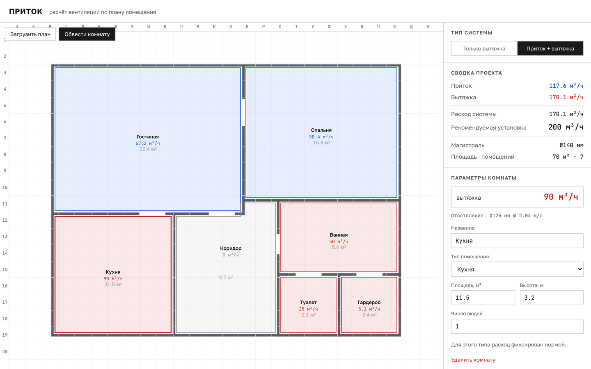

# Приток

Веб-платформа для расчёта вентиляции без инженера. Пользователь загружает план
помещения, обводит комнаты, задаёт параметры — получает расчёт воздухообмена и
подбор сечений воздуховодов. Всё считается в браузере, без бэкенда.

### [▶ Открыть демо](https://tolibovmuhamad.github.io/Pritok/)




## Как пользоваться

1. Перетащите в окно план квартиры (картинку) или нажмите «Загрузить план». Можно обойтись и без плана.
2. Нажмите «Обвести комнату» и кликайте по углам. Клик по первой точке замыкает контур.
3. Укажите тип помещения, площадь, высоту и число людей. Расчёт пересчитывается сразу.
4. Справа — сводка по квартире: приток, вытяжка, рекомендуемая производительность установки и диаметр магистрали.

## Что умеет

- Нормы для 7 типов помещений: жилая комната, кухня, ванная, туалет, прачечная, гардероб, коридор.
- Две схемы: «только вытяжка» и «приток + вытяжка».
- Подбор диаметра воздуховода для каждой комнаты и для магистрали с учётом скорости воздуха.
- Чертёжный стиль: координатная сетка с осями, синий — приток, красный — вытяжка.
- Расчётное ядро — чистый модуль без UI, покрыт тестами на контрольном примере (квартира 484 м², 28 помещений).

Стек: **React + Vite**, холст — **SVG**, тесты — **Vitest**.

## Запуск

```bash
npm install
npm run dev      # http://localhost:5173
npm test         # юнит-тесты расчётного ядра
npm run build    # production-сборка
```

## Архитектура

### Этап 1 — расчётное ядро (`src/core/ventilation.js`)

Чистый модуль без зависимостей от UI. Все нормы вынесены в справочник
`ROOM_TYPES`, что упрощает проверку тестами.

**Нормы расхода по типам помещений:**

| Тип | Направление | Формула |
|---|---|---|
| Жилая комната | приток | площадь × 3 м³/ч |
| Кухня | вытяжка | 90 м³/ч |
| Ванная / большой санузел | вытяжка | 50 м³/ч |
| Маленький санузел / туалет | вытяжка | 25 м³/ч |
| Прачечная | вытяжка | 75 м³/ч |
| Гардероб / кладовая | вытяжка | площадь × 1.5 м³/ч |
| Коридор / прихожая | переток | 0 |

**Расход системы:**
- «только вытяжка» = сумма вытяжки;
- «приток + вытяжка» = max(сумма притока, сумма вытяжки).

**Рекомендуемая установка** = расход системы × 1.15, округление вверх до сотни.

**Сечение воздуховода:** S (м²) = расход (м³/ч) ÷ 3600 ÷ скорость (м/с);
скорость 3.5 м/с на магистрали, 2.5 м/с у комнаты; результат округляется вверх
к ближайшему стандартному диаметру.

**Контрольный пример SAFO** (`src/core/fixtures/safo.js`) — квартира 484 м²,
28 помещений. Балансная схема даёт приток **861 м³/ч**, вытяжку **539.5 м³/ч**,
рекомендуемую установку **1000 м³/ч**. Проверяется в `ventilation.test.js`.

### Этап 2 — UI (`src/App.jsx`, `src/components/PlanCanvas.jsx`)

1. Загрузка плана как подложки (drag&drop файла или выбор).
2. Обводка комнаты кликами по углам (полигон поверх подложки).
3. Форма параметров комнаты (тип, площадь, высота, число людей) с живым
   пересчётом.
4. Переключатель схемы: «только вытяжка» / «приток + вытяжка».
5. Сводка проекта: приток, вытяжка, расход системы, рекомендуемая установка,
   магистраль.

Стиль: белый чертёжный фон, координатная сетка с осями А/Б/В и 1/2/3,
шрифт Golos Text (моноширинный для цифр), синий — приток, красный — вытяжка.

## Деплой

Демо собирается и публикуется на GitHub Pages автоматически при каждом пуше в
основную ветку (`.github/workflows/deploy.yml`): сначала прогоняются тесты, потом сборка.
